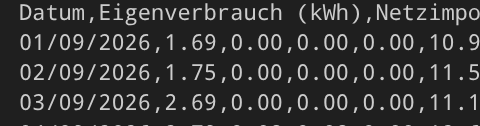
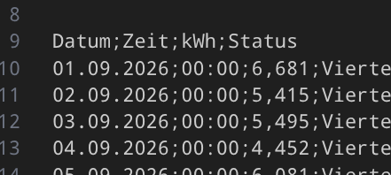
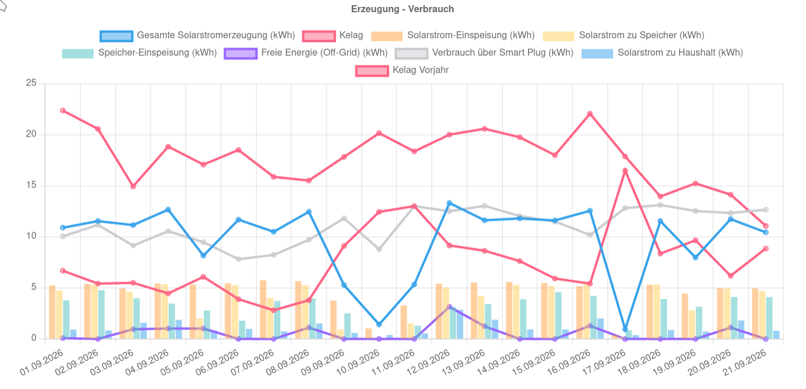

# CSV to chart.html converter

## Beschreibung 
___
Erstellt Charts[^first] als HTML-Datei aus CSV-Dateien. Praktisch für monatliche Charts bei denen zusätzliche Daten (andere CSV) desselben Monats mit Vorjahresvergleich (nochmal andere CSV) verbunden werden sollen. Nur noch die Dateien auswählen und Charts im Browser anschauen.



ergänzt mit Daten aus anderen csv Dateien



erzeugt ein neues CSV mit ergänzten optionalen Daten und Charts   als HTML Datei



* Installation folge [Setup](#1-setup)
* Konfiguration folge [Konfiguration](#3-konfiguration)
    * Datei ```convertCsvToChartHtml.py```: excutes step by step
    * Datei ```chartsCfg.py```: Kofiguration der Charts
    * Datei ```directories.py```: Kofiguration Ordner und CSV-Info 
* Example Data folge [Setup](#12-starte-die-installation)

## 1. Setup
___
### 1.1 Download zip File
Python[^second] wird benötigt
download aktuelle Version https://github.com/gursche/convertCsvToChartHtml

### 1.2 Starte die Installation

1.2.1. entpacke zip und starte in der Console

```sh
    python convertCsvToChartHtml-main
```
nach der Installation kann der Ordner ```convertCsvToChartHtml-main``` gelöscht werden.

1.2.2. **do you want to install example data?(y/n)**
+ y - installiert Beispieldaten und Konfiguration
+ n - nicht

1.2.3. **install chart.js localy?(y/n)**
+ y - installiert chart.js lokal: chartJS/chart.umd.min.js
+ n - verwendet: https://cdn.jsdelivr.net/npm/chart.js
        
1.2.4. **do you want to set directories manually?(y/n)**
+ y - letzter Schritt
+ n - Notwendige Parameter werden abgefragt

    Notwendige Parameter

        Ordner:
        
            initialDir=Ordner der ersten CSV
            optionalCsvDir=Ordner der zweiten CSV
            destinationDir=Ordner in dem gespeichert wird

        CSV Info:

            seperator: welche(s) Zeichen trennt die Spalten
            columnHeaderRow: in welcher Zeile befinden sich die Spaltenüberschriften
            columnDataFromRow: ab welcher Zeile befinden sich Daten
            columnDataWhereTf: zweite(+) CSV, Spalte der Daten

    ***beginne das Zählen der Zeilen und Spalten bei 0***
    sind die Ordner nicht erreichbar, ist ein OS Fehler zu erwarten. 

## 2. Wie verwenden
___
2.1. öffne linux: Terminal, mac: console, win: cmd und füge ein:

```sh
python convertCsvToChartHtml.py
```
## 3. Konfiguration
___

### 3.1 Datei ```convertCsvToChartHtml.py```

#### 3.1.1. new MyCharts 
```MyCharts=ChartData('',language='de')```
+ language='de' ändert lokale Formatierung: Datum und Zahlen
+ language='en' nimmt keine Veränerungen vor

#### 3.1.2.  Haupt CSV
```MyCharts.startImport(initialDir, destinationDir, initialCsvInfo)```
die Hauptcsvdatei wird anhand der initialDir abgefragt, die destinationDir wird gesetzt und die initialCsvInfo übergeben.
+ Spalte 0 Datum
+ ab jetzt kann csv und html geschrieben werden

#### 3.1.3. Zusatz CSV
```MyCharts.addAditionalCsv(optionalCsvDir,header,optionalCsvInfo)```
die Zusatzcsvdatei wird abgefragt, header ist der Name der neuen Spalte, optionalCsvInfo wird übergeben
+ auch hier Spalte 0 Datum
+ Datum wird kontrolliert, Tag und Monat müssen vorhanden sein
+ vergleich Monat mit Monat und Vorjahr
+ ab jetzt kann csv und html geschrieben werden

***3.1.4. Wiederholung für das Vorjahr
    siehe Punkt 3***

#### 3.1.5. CSV exportieren
```MyCharts.writeCsv()```
    schreibt die Daten in eine CSV Datei

#### 3.1.6. Chart Konfiguration importieren
```MyCharts.importCFG(chartCFG())```
    importiert die Chart-Konfiguration und bereitet die Daten vor

#### 3.1.7. HTML exportieren
```MyCharts.writeHtmlFile()```
    schreibt die Daten in eine HTML-Datei

#### 3.1.8. Spaltenüberschriften
```MyCharts.printHeader()```
    zeigt Liste der Spaltenüberschriften

### 3.2. Datei ```chartsCfg.py```
Konfigurationsdatei:

#### 3.2.1. neue chart
```chart={ 'title':'PV Erzeugung',```
hier geht es um Photovoltaik, mein Titel: PV Erzeugung.

#### 3.2.2. Spalten wählen
als Nächstes werden die sichtbaren Spalten definiert, siehe 3.1.8 Spaltenüberschriften 
```
    'columns':[5,12,13,14,15,10,11,22],
```
#### 3.2.3. SpaltenType zuweisen
jede Spalte **muss** einen typ haben: line oder bar
```
    'columnsType':['bar','line','line','line','line','line','line','line'],
```
#### 3.2.4. Beispieldaten
```
5:   Gesamte Solarstromerzeugung (kWh) 
12:   'PV1-Erzeugung (kWh)'
13:   'PV2-Erzeugung (kWh)' 
14:   'PV3-Erzeugung (kWh)'
15:   'PV4-Erzeugung (kWh)' 
10:   'Speicher zu Haushalt (kWh)'
11:   'Speicher-Einspeisung (kWh)'
22:   'Freie Energie (Off-Grid) (kWh)'
```  
#### 3.2.5. Options 
Die Linien und Säulen können gestapelt werden, PV1-PV4 übereinander ergeben gesamt (5), das wäre staked.
Jede Linie für sich selbst, das wäre Default.
Nach jeder Chart
#### 3.2.6. Chart an Charts anhängen
Damit chart['columns'] und chart['columnsType'] die gleiche Länge haben, wird das kontrolliert. Fehlersuche in der Konsole.
```
if len(chart['columns']) == len(chart['columnsType']):
    charts.append(chart)
else:
    print(chart['title'],'not added -> columns: ',len(chart['columns']),' columnsType: ',len(chart['columnsType']))
#end define chart
```
#### 3.2.7. Datenübergabe
Datei importieren und chartCFG() verwenden

### 3.3. Datei ```directories.py```
Konfiguration von Standardordner und Zusatzinformationen
#### 3.3.1 initialDir
Standardordner der Hauptcsv, Dateiabfrage beginnt hier
#### 3.3.2 destinationDir
Standardordner für die exportierten Daten
#### 3.3.3 optionalCsvDir
Standardordner der zusätzliche CSV
#### 3.3.4 initialCsvInfo und optionalCsvInfo
sind soweit identisch, dass sie columnHeaderRow, columnDataFromRow und seperator benötigen. Optionale Data benötigt auch die Spalte in der sich die Daten befinden.
##### 3.3.5 columnHeaderRow
in welcher Zeile sind die Spaltenüberschriften
##### 3.3.6 columnDataFromRow
ab welcher Zeile werden Daten erwartet
##### 3.3.7 columnDataWhereTf
bei der zusätzlichen CSV Datein wird nur eine Spalte übernommen in welcher Spalte steht der Wert? 
##### 3.3.8 seperator
CSV Dateien sind Separator(,, |, ;, ...) getrennte Tabellen, welcher wird verwendet?
#### 3.3.9 Beispiel
```
initialCsvInfo={
        'columnHeaderRow':1,
        'columnDataFromRow':2,
        'columnDataWhereTf':-1,
        'seperator':','
    }
```
+ Zeile 0 hat keine Spaltenüberschrift
+ Zeile 1 Spaltenüberschriften 
+ Zeile 2 ab Zeile 2 sind Daten zu erwarten
+ Seperatorzeichen: ,
+ columnDataWhereTf nur bei optionalCsvInfo in Verwendung

[^first]: Footnote **chart.js**
    powerd by https://www.chartjs.org/
    wird für die Charts benötigt
    
[^second]: Footnote **python**
    Für die aktuellste Python Version: https://www.python.org
